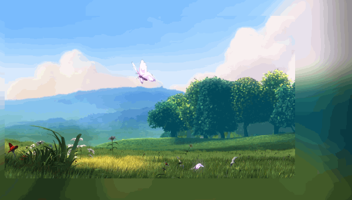
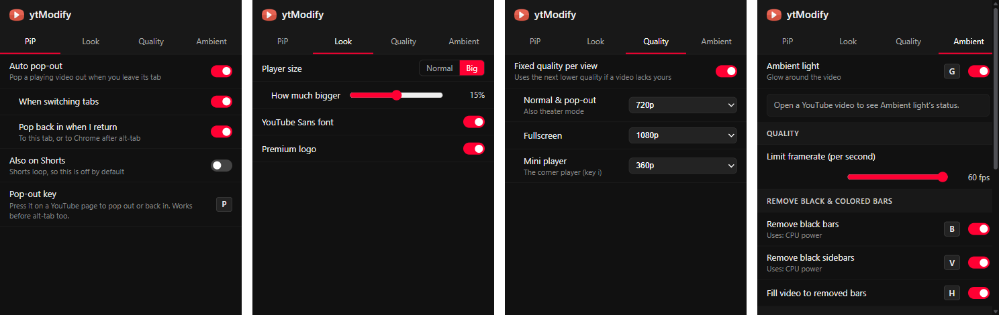

# ytModify

**One Chrome extension that makes YouTube nicer to watch.**

Ambient glow · Auto pop-out · Fixed quality per view · Bigger player

## Features

- 🌈 **Ambient light**: a soft glow around the video that follows its colours. It can also remove black bars.
- 📺 **Auto pop-out**: the video pops into a small floating window when you switch tabs, and back when you return. Press **`P`** to pop out any time.
- 🎯 **Fixed quality per view**: for example 1080p in fullscreen, 720p normally and 360p in the mini player.
- 🔍 **Look**: a bigger player, the YouTube Sans font and the Premium logo.
- 🔒 **Private**: no tracking, no analytics, nothing is sent anywhere.

Everything is set from one popup, and changes apply instantly:

## Install

1. Download `ytModify.zip` from [Releases](../../releases) and unzip it.
    Or build it yourself: `npm install`, then `npm run build`. The extension is then in `dist/`.
2. Open `chrome://extensions` and turn on **Developer mode** (top right).
3. Click **Load unpacked** and choose the unzipped folder (or `dist`).

## Keyboard shortcuts

On a YouTube page:

| Key | Does |
|:---:|---|
| `P` | Pop the video out / back in |
| `G` | Ambient light on / off |
| `B` | Remove black bars |
| `V` | Remove black sidebars |
| `H` | Fill the video into removed bars |

You can change any of these keys in the popup.

> **Why `P`?** Chrome only lets a page open a pop-out by itself on a tab switch. For anything else, including alt-tab, it needs a key press, so press `P` first.

## Credits

- [Ambient light for YouTube™](https://github.com/WesselKroos/youtube-ambilight) by Wessel Kroos (MIT). Its licence is in [`src/ambient/LICENSE-ambient-light.txt`](src/ambient/LICENSE-ambient-light.txt).
- YouTube Premium svg logo by Phoenix~ (CC BY-NC 4.0).
- Auto pop-out and bigger player by Mogdho Paul.
- Demo video: *Big Buck Bunny* © Blender Foundation (CC BY 3.0).

YouTube is a trademark of Google LLC. This project isn't affiliated with Google.

Developer notes: [docs/development.md](docs/development.md).

## License

[GPL-3.0](LICENSE)
